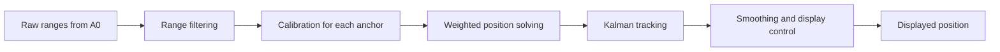

# UWB Localisation for Tabletop Robots

Real time UWB localisation for small spinning robots on a tabletop play field. Three Ai Thinker BU03 anchors and one BU03 tag measure ranges, and a Python host program turns them into a planar position shown live in a browser. Every live run is saved, so the same measurements can be replayed and processed again.

Small robots need reliable positions to move on their own and to interact, for example by chasing or avoiding another robot. Early tests showed that raw ranges at these short distances were biased and sometimes interrupted, so the processing method was developed step by step using recorded data. The repository includes the host software, the final method, the experimental recordings and the evaluation scripts from a university engineering capstone project.

## Main features

- Live localisation in the browser based Localisation Monitor.
- Processing in five stages, from range filtering and calibration for each anchor to Kalman tracking and display control.
- Recording and replay using the original measurement times.
- Stationary and handheld movement recordings from a 0.6 m layout and a 1 m layout.
- Scripts and tests that reproduce the reported results.

## How it works



[Method details](docs/method.md) explain each stage and its settings.

## Results

| Test | Result |
| --- | --- |
| Stationary position error at nine positions in the 1 m layout | RMSE from 1.55 cm to 6.79 cm |
| Frames with a displayed position during movement | 78.32% |

The movement tests measure display availability and the handling of reception interruptions.

## Install

Use Python 3.11 or later. Run the following commands from the project directory.

```bash
python3 -m venv .venv
source .venv/bin/activate
python -m pip install -e '.[test]'
```

On Windows, activate the environment with `.venv\Scripts\activate`.

## Replay a recording

Replay uses the supplied recordings and needs no hardware.

```bash
uwb replay data/one_metre/from_a2_run1
```

Open the local address printed by the program. The replay interface uses the same layout as the live Localisation Monitor and shows positions and anchor ranges. Playback controls change the viewing time and speed, while processing always uses the original measurement times.

| Position | Meaning |
| --- | --- |
| Tracked position | Position calculated from the range readings before the extra smoothing used for display. |
| Displayed position | Position shown after smoothing and display checks. It can stay visible briefly between updates. |
| Original recorded position | Tracked position saved during the original run. Replay shows it alongside the newly processed positions for comparison. |

The blue marker shows the tracked position, and the red marker shows the displayed position. Select `Original recording` to show the saved position in grey. The same explanations appear in the position guide at the bottom of the interface.

To export the processed frame results, run

```bash
uwb replay data/one_metre/from_a2_run1 --no-browser --export results/replay.jsonl
```

Use `--config` before the command to select a different processing configuration.

```bash
uwb --config configs/final.json replay data/one_metre/centre_facing_a0
```

## Run with hardware

The boards keep their manufacturer firmware. See [hardware setup](docs/hardware.md) for board roles and serial connections.

```bash
uwb ports
uwb live --port /dev/cu.usbmodemXXXX --output recordings/run01
```

Replace the example port with the A0 USB data port listed on your computer. Windows ports normally use names such as `COM3`. Each run creates a new recording directory and stores the received measurements and processing results. Stop the program with Ctrl-C.

To record for 10 s from the terminal, run

```bash
uwb capture --port /dev/cu.usbmodemXXXX --seconds 10 --output recordings/run02
```

## Reproduce the results

```bash
python scripts/evaluate.py
python scripts/fit_calibration.py
python -m pytest
```

The evaluation reprocesses the 1 m recordings with the final method and an earlier version. Both versions use the same settings apart from two refinements made late in development. The calibration script refits the curve for each anchor from the supplied stationary data.

## Project contents

| Location | Contents |
| --- | --- |
| `src/uwb_localisation/` | Serial input, final tracking method and live and replay interfaces. |
| `configs/final.json` | Geometry, calibration coefficients and processing settings. |
| `data/one_metre/` | Nine stationary recordings and six movement recordings. |
| `data/early_0p6m/` | Five early recordings and the saved results of the offset calibration check. |
| `scripts/` | Numerical evaluation and calibration fitting. |
| `tests/` | Protocol, algorithm, timing and replay checks. |
| `docs/` | Hardware setup, method explanation and data descriptions. |

[Data descriptions](docs/data.md) explain the reference positions, the split between fitting and checking data, and the recorded files.

## Licence and references

The original code, documentation and supplied experimental data are provided under the [MIT licence](LICENSE). [References and dependencies](THIRD_PARTY.md) identify the method references and separately installed dependencies.
